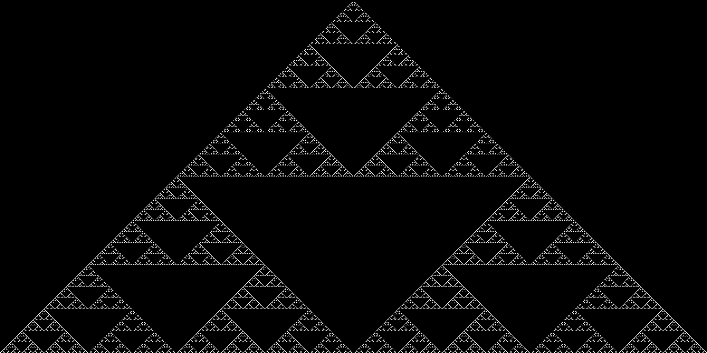
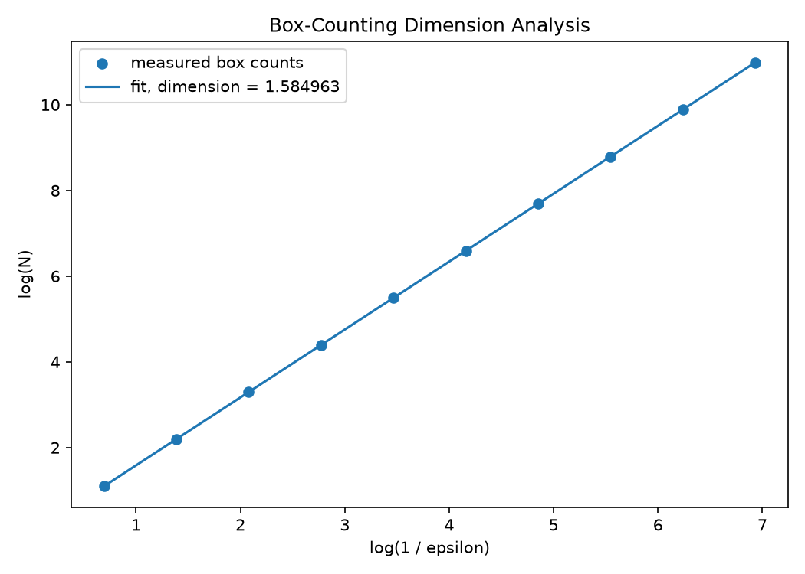

# Binary-Address Sierpinski Gasket

This project generates a Sierpinski gasket using the binary-address / Pascal-triangle parity method from Section 2.10 of *Fractals for the Classroom*. Instead of drawing triangles recursively, it tests integer coordinates with a bitwise condition that reveals the same self-similar pattern.

## Fractal output



The image shows the selected binary-address points rendered as a centred Sierpinski gasket. The black background represents unselected raster positions, and the white points represent coordinates that pass the Pascal-parity bitwise test.

## How the fractal is formed

The implementation uses triangular integer coordinates satisfying:

```text
x <= y
```

For each coordinate, it tests:

```text
x & (y - x) == 0
```

Here `&` is bitwise AND.

The binary-address interpretation is:

- write `x` and `y - x` in binary
- select the point only when they do not contain a `1` in the same bit position
- equivalently, their bitwise AND is zero

This is connected to the parity pattern of Pascal's triangle. A binomial coefficient is odd exactly when the corresponding binary addition has no carries. The positions with odd parity form the familiar Sierpinski gasket pattern.

## PyTorch implementation and parallelism

PyTorch is the main computational component of the implementation in `src/sierpinski.py`.

The function `generate_sierpinski_mask(size, device)` uses:

- `torch.arange` to create integer coordinate values
- `torch.meshgrid` to form the full two-dimensional coordinate grid
- `torch.bitwise_and` to apply the binary-address test
- boolean tensor operations for `x <= y` and the final selected mask
- tensor indexing to place selected points into the rendered output image

The implementation does not use nested Python loops over individual pixels. Instead, the full coordinate grid is represented as PyTorch tensors, and the binary-address test is evaluated with vectorised tensor operations across the grid.

This is data parallelism: the same operation is applied independently to many coordinates. The code can run on CPU, and the same tensor formulation is suitable for parallel execution by PyTorch-supported hardware.

## Box-counting dimension analysis

The script `analysis/fractal_dimension.py` performs box-counting analysis on the logical Sierpinski boolean mask returned by `generate_sierpinski_mask()`, not on the rendered PNG.

This matters because the rendered image contains a centring/shearing transformation and additional horizontal raster spacing used only for visualisation. The logical `1024 x 1024` mask represents the mathematical binary-address construction directly, so it is the appropriate object for quantitative analysis.

The method is:

- grid size = `1024 = 2^10`
- box sizes = `1, 2, 4, ..., 512`
- for each scale, count the number `N(epsilon)` of boxes containing at least one selected point
- fit `log(N)` against `log(1 / epsilon)`
- use the slope as the estimated box-counting dimension

Measured box counts:

| Box size | Epsilon | Occupied boxes |
| ---: | ---: | ---: |
| 1 | 0.000977 | 59049 |
| 2 | 0.001953 | 19683 |
| 4 | 0.003906 | 6561 |
| 8 | 0.007812 | 2187 |
| 16 | 0.015625 | 729 |
| 32 | 0.031250 | 243 |
| 64 | 0.062500 | 81 |
| 128 | 0.125000 | 27 |
| 256 | 0.250000 | 9 |
| 512 | 0.500000 | 3 |

```text
Estimated box-counting dimension = 1.584963
```

The theoretical Sierpinski dimension is:

```text
D = log(3) / log(2) = 1.584963
```

For these discrete power-of-two scales, the measured absolute error is:

```text
0.000000e+00
```

The counts follow powers of three because, for a size `2^10` construction, the finest scale contains `3^10 = 59049` selected points. Doubling the box size reduces the number of occupied self-similar boxes by a factor of three.



## Running the project

Run commands from the repository root.

To generate the Sierpinski gasket:

```bash
python src/sierpinski.py
```

To run the dimension analysis:

```bash
python analysis/fractal_dimension.py
```

Generated files:

```text
outputs/sierpinski_binary.png
outputs/fractal_dimension.png
```

The scripts use Python, PyTorch, and Matplotlib.

## Repository structure

```text
.
├── AGENTS.md
├── README.md
├── analysis/
│   └── fractal_dimension.py
├── jobs/
│   └── sierpinski_job.sh
├── outputs/
│   ├── fractal_dimension.png
│   └── sierpinski_binary.png
├── prompts.md
└── src/
    └── sierpinski.py
```

`prompts.md` records the AI-assisted development prompts, visible assistance summaries, problems encountered, and changes made. It does not claim access to hidden chain-of-thought reasoning.

## Key result

The binary-address construction successfully generates the expected Sierpinski gasket. PyTorch tensor operations implement the construction without per-pixel Python loops. The quantitative box-counting analysis reproduces the theoretical dimension `log(3) / log(2)`.
